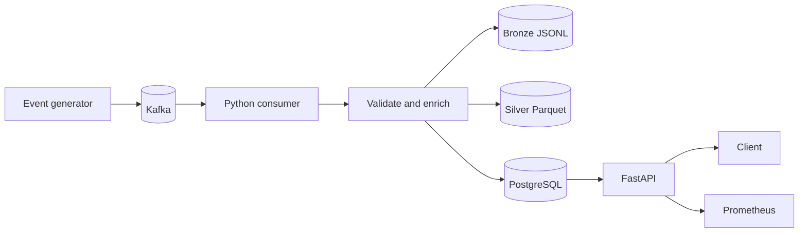

# StreamForge — Real-Time Data Intelligence Platform

**Foundation release · Python 3.12 · Kafka · PostgreSQL · S3/Parquet · FastAPI · AWS Terraform**

StreamForge is an event-driven analytics reference implementation. It ingests synthetic commerce events through Kafka, validates and enriches them, writes Parquet data to S3-compatible object storage, and serves operational analytics through FastAPI and PostgreSQL.

> Scope: this milestone includes a local Docker Compose stack, producer/consumer, idempotent database persistence, MinIO bronze/silver storage, API, Prometheus metrics, unit tests, CI and an AWS S3/Terraform foundation. It does not yet deploy the runtime to ECS or provision MSK.

## Architecture


## Run locally
Requirements: Docker Engine and Compose v2.
```bash
cd projects/streamforge
cp .env.example .env
docker compose up --build -d
docker compose run --rm producer --count 1000 --rate 100
curl http://localhost:8000/health
curl http://localhost:8000/v1/analytics/summary
curl "http://localhost:8000/v1/events/recent?limit=20"
```

| Service | Address |
|---|---|
| API docs | http://localhost:8000/docs |
| Prometheus | http://localhost:9090 |
| MinIO console | http://localhost:9001 |
| PostgreSQL | localhost:5432 |
| Kafka external listener | localhost:29092 |\n| Kafka dead-letter topic | commerce.orders.dlq.v1 |

## Data design
- Bronze: validated source records as JSON Lines.
- Silver: enriched Parquet with ingestion time, event age, gross value and anomaly flags.
- Serving: PostgreSQL event table and aggregate API.

Kafka offsets are committed after sink persistence; PostgreSQL upserts on stable event UUIDs. This is **at-least-once**, not exactly-once. A crash between object-store upload and offset commit can duplicate lake files; production hardening needs deterministic batch IDs and reconciliation.

Anomaly flags use configurable amount/quantity thresholds. These are transparent demo rules, not a trained fraud model.

## Reliability and operations

Malformed events are routed to `commerce.orders.dlq.v1` with original source coordinates. Kafka offsets are committed per partition only after PostgreSQL, object storage and DLQ writes succeed. See [the operations runbook](docs/OPERATIONS.md) and [security notes](docs/THREAT_MODEL.md).

The versioned event contract is published at [order-event-v1.schema.json](contracts/order-event-v1.schema.json).

Database schema is managed through Alembic migrations. Compose runs the one-shot `migrate` service before starting the API and worker; production deployments should run the migration as a controlled release job.

## Quality
```bash
python -m pip install -e ".[dev]"
ruff check .
pytest -q
```

## Spark Structured Streaming

An optional PySpark implementation is included under `spark/streaming_job.py`. It reads Kafka with Structured Streaming, validates the event contract, deduplicates by event ID with a two-hour watermark, derives gross value/anomaly flags, and writes partitioned Parquet to MinIO/S3. Invalid events are written to a separate Parquet DLQ path.

Run it in a separate terminal after the local stack is up:
```bash
docker compose --profile spark run --rm spark-streaming
```
The Python worker and Spark job are alternative consumer implementations. Run only the intended consumer in a real deployment to avoid duplicate processing/costs. Spark downloads its Kafka and S3A connector JARs on first startup.

See the [AWS deployment guide](docs/DEPLOYMENT_AWS.md) for credentials, plan/apply and teardown. It clearly distinguishes the S3 foundation from the runtime components that still need to be deployed.

## AWS foundation
Terraform in infra/terraform provisions private, versioned S3 buckets for bronze, silver and gold, KMS encryption, public-access blocks and lifecycle configuration. Default region is eu-central-1 (Frankfurt).
```bash
cd infra/terraform
terraform init
terraform fmt -check
terraform validate
terraform plan -var="project_name=streamforge" -var="environment=dev"
```
Review the plan and AWS pricing before applying; resources can incur charges. Use AWS profiles/environment credentials; never commit secrets. ECS/Fargate, MSK, VPC, IAM roles, Secrets Manager, alarms and cost controls are subsequent milestones.

## Roadmap
- [x] Synthetic producer and versioned event contract
- [x] Kafka consumer with validation and manual commits
- [x] Idempotent PostgreSQL persistence
- [x] Bronze JSONL and Silver Parquet object storage
- [x] FastAPI analytics and Prometheus metrics
- [x] Docker Compose, unit tests and CI
- [x] AWS encrypted S3 foundation
- [ ] Integration and crash/replay tests
- [ ] dbt models and data-quality assertions
- [ ] Spark Structured Streaming and throughput benchmarks
- [ ] AWS ECS/Fargate + MSK deployment
- [ ] Grafana dashboards, alerts and load tests

See architecture/decisions.md for trade-offs.
